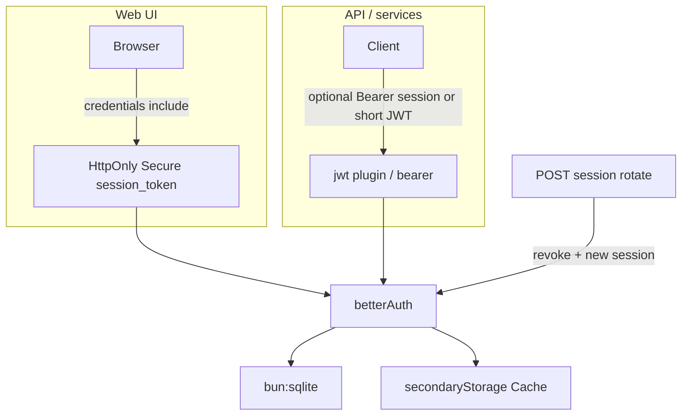

# Better Auth native migration

## Decision (locked)

Adopt **Better Auth natively** at `/api/auth/`_ with **username** plugin. Drop custom JWT/refresh handlers and `/auth/`_. No API compatibility layer.

**Client split (security):**

- **Web UI**: Better Auth **HttpOnly + Secure** session cookies (`credentials: "include"`). Do **not** store session tokens in `sessionStorage`.
- **Non-browser / API clgients**: optional **bearer** plugin still available; prefer short-lived JWT from the **jwt** plugin where a portable access token is needed.

## Stolen-token controls (from todos)

Capability check vs Better Auth, then how we implement:

| Requirement                        | In Better Auth?                                                                                                                                                                                                                                    | Plan                                                                                                                                                                                                               |
| ---------------------------------- | -------------------------------------------------------------------------------------------------------------------------------------------------------------------------------------------------------------------------------------------------- | ------------------------------------------------------------------------------------------------------------------------------------------------------------------------------------------------------------------ |
| **HttpOnly + Secure Cookie (Web)** | **Yes** — cookies are `httpOnly`; `secure` in production (force with `advanced.useSecureCookies`)                                                                                                                                                  | Configure BA cookies; rewrite UI to cookie-based auth (`credentials: "include"`). Set `SameSite` via cookie attributes as needed.                                                                                  |
| **Short-lived Access Token**       | **Partial** — core auth is a **session** cookie (long-lived, sliding). **jwt** plugin issues short-lived JWTs (default **15m**, configurable); docs say JWT is for services, not a full session replacement. Cookie cache can also be short-lived. | Enable `**jwt()`\*\* plugin with short `jwt.expirationTime` (env, default 15m). Web relies on HttpOnly session cookie; APIs that need a short token call `/api/auth/token` (or use `set-auth-jwt` on get-session). |
| **Refresh Token Rotation**         | **No** classic opaque refresh-token rotation (one-shot RT + reuse detection). BA has sliding session (`session.expiresIn` / `updateAge`) and cookie-cache refresh — **not** the same.                                                              | **Implement ourselves** on top of BA: a small rotation endpoint that revokes the current session and creates a new one; reject reuse of the old session token. Cover with tests.                                   |



## Target shape

| Concern          | Approach                                                                                        |
| ---------------- | ----------------------------------------------------------------------------------------------- |
| DB               | `Database` from `bun:sqlite` on same `SQLITE_PATH`                                              |
| App `SQL`        | Keep for non-auth / migrations; stop using for auth tables                                      |
| Web session      | BA signed **HttpOnly** cookie; **Secure** in production (`useSecureCookies` when TLS/prod)      |
| Short access JWT | `jwt()` plugin; TTL via env (default 15 minutes)                                                |
| Session rotation | Custom handler using `auth.api` revoke + re-sign-in/session create; invalidate secondaryStorage |
| Redis            | Existing `[Cache](src/cache/cache-types.ts)` → BA `secondaryStorage` (no ioredis)               |
| Mail             | Existing `[Mailer](src/mail/mailer-types.ts)` for reset + verify                                |
| Password         | `Bun.password` via `emailAndPassword.password.hash/verify`                                      |

## Package

- `bun add better-auth`
- Plugins: `username()`, `jwt()`, `bearer()` (API clients only; Web prefers cookies)

## New modules

| Path                                                             | Role                                                                                           |
| ---------------------------------------------------------------- | ---------------------------------------------------------------------------------------------- |
| `[src/auth/better-auth.ts](src/auth/better-auth.ts)`             | Factory: email/password, username, jwt, bearer, secondaryStorage, mail, cookie/session options |
| `[src/auth/secondary-storage.ts](src/auth/secondary-storage.ts)` | `Cache` → BA secondary storage                                                                 |
| `[src/auth/session-rotate.ts](src/auth/session-rotate.ts)`       | Rotation: validate session → revoke → issue new session (cookie + optional bearer header)      |
| `[src/constants/better-auth.ts](src/constants/better-auth.ts)`   | Secrets, URLs, `ACCESS_JWT_TTL`, `SESSION_EXPIRES_IN`, `SESSION_UPDATE_AGE`, cookie flags      |

Schema: generate with `bunx --bun auth@latest generate` (includes jwt `jwks` table); commit under migrations; drop legacy auth tables.

## Cookie / session / JWT config (essentials)

```ts
// illustrative — constants from env, not literals in call sites
session: {
  expiresIn: SESSION_EXPIRES_IN_SECONDS,   // e.g. 7d
  updateAge: SESSION_UPDATE_AGE_SECONDS,     // e.g. 1d sliding
  cookieCache: { enabled: true, maxAge: COOKIE_CACHE_MAX_AGE }, // short-lived cache
},
advanced: {
  useSecureCookies: isProduction, // or always when TLS
  // httpOnly is BA default for session_token
},
plugins: [
  username(),
  jwt({ jwt: { expirationTime: ACCESS_JWT_EXPIRATION } }), // short-lived access JWT
  bearer(),
],
```

## Session rotation (custom)

Because BA lacks classic RT rotation:

1. Route e.g. `POST /api/auth/session/rotate` (or mount beside BA handler).
2. Read current session from cookie / Bearer.
3. If invalid → 401.
4. Revoke that session id (DB + secondaryStorage).
5. Create a new session for the same user; set new HttpOnly cookie (and `set-auth-token` if bearer clients).
6. Tests: rotated old token fails; concurrent reuse of old token fails after revoke.

## App wiring

1. `[createApp](src/app.ts)`: auth + cache + mailer; close bun:sqlite + Redis.
2. `[buildServeRoutes](src/server/serve-routes.ts)`: remove `/auth/*`; mount `/api/auth/*` → `auth.handler`; add rotation route; rate-limit both.
3. Guards: `auth.api.getSession({ headers })`.
4. Update `[routes.ts](src/constants/routes.ts)` + `[api-docs-sections.ts](src/server/api-docs-sections.ts)`.

## Features (parity)

- Sign up / sign in / sign out via BA.
- Password reset + email verification via BA + Mailer.
- Username via plugin.
- Short-lived access JWT via jwt plugin.
- Session rotation via custom endpoint (not BA refresh-token product feature).

## Remove

Custom jwt/session/auth-tokens/user-queries, `[src/server/auth/*](src/server/auth/)`, legacy tables (`users`/`sessions`/`password_resets`/`email_verifications`), old JWT env docs.

## UI (`[src/ui/auth-page-html.ts](src/ui/auth-page-html.ts)`)

- Fetch BA endpoints with `**credentials: "include"**`.
- Rely on **Set-Cookie**; no `sessionStorage` for session/access secrets.
- Optional: fetch short JWT from `/api/auth/token` only if a demo needs it — do not persist long-lived tokens in JS storage.
- Call rotation endpoint when demonstrating refresh (or on a timer / before expiry).

## Seed / tests / env

- Seed via `auth.api.signUpEmail`.
- Rewrite auth tests for cookies + rotation + short JWT TTL; keep password-reset / email-verify with in-memory mailer.
- Env: `BETTER_AUTH_SECRET`, `BETTER_AUTH_URL`, `ACCESS_JWT_EXPIRATION` / TTL seconds, session expire/update ages; keep `REDIS_URL`, `SQLITE_PATH`.

## Implementation order

1. Dependency + schema (BA + jwt) + drop legacy tables.
2. `createBetterAuth` (cookies Secure/HttpOnly, jwt TTL, secondaryStorage, mail).
3. Session rotation module + tests.
4. Mount routes; delete old auth code.
5. Cookie-based UI + docs + seed + `.env.example`.
6. Full auth test rewrite; `bun test`.

## Out of scope

- Social OAuth / 2FA / orgs
- Changing `[todos.ts](todos.ts)`
- Replacing app HTTP rate limiter entirely with BA’s
