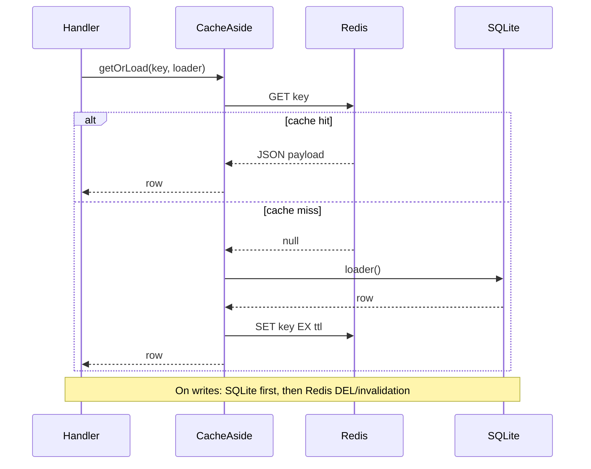

# DB + Redis cache-aside

## Current state

- SQLite via Bun [`SQL`](src/db/client.ts) — no ORM, queries inline in auth modules.
- App wiring in [`createApp`](src/app.ts) passes `{ sql, uploadDir, mailer }` into [`buildServeRoutes`](src/server/serve-routes.ts).
- **No Redis** today; only in-process caches (JWT secret, rate-limit `Map`).
- Zero runtime npm deps — use **Bun built-in** `RedisClient` from `"bun"` (reads `REDIS_URL` / `VALKEY_URL`).

## Target architecture

## Module layout (new)

| Path                                                   | Role                                                                                          |
| ------------------------------------------------------ | --------------------------------------------------------------------------------------------- |
| [`src/constants/redis.ts`](src/constants/redis.ts)     | `ENV_REDIS_URL`, `ENV_CACHE_ENABLED`, TTL constants                                           |
| [`src/cache/cache-types.ts`](src/cache/cache-types.ts) | `Cache` interface: `get`, `set`, `del`, `ping`                                                |
| [`src/cache/redis-cache.ts`](src/cache/redis-cache.ts) | `RedisClient` adapter (JSON serialize/deserialize)                                            |
| [`src/cache/noop-cache.ts`](src/cache/noop-cache.ts)   | Pass-through for tests only                                                                   |
| [`src/cache/cache-aside.ts`](src/cache/cache-aside.ts) | `getOrLoad`, `invalidate` helpers                                                             |
| [`src/cache/keys.ts`](src/cache/keys.ts)               | Namespaced keys: `user:id:`, `user:email:`, `session:`, `auth-token:`                         |
| [`src/cache/client.ts`](src/cache/client.ts)           | `createCacheBundle()` / `closeCacheBundle()` — mirrors [`src/db/client.ts`](src/db/client.ts) |

**Key naming** (prefix from constant, e.g. `app:`):

- `user:id:{uuid}` → `UserRow` (omit `passwordHash` from cache when only id/email needed; cache full row for sign-in path)
- `user:email:{normalizedEmail}` → `UserRow` or `{ id }` subset
- `session:id:{uuid}` → `SessionRow` (token verification still runs after cache hit)
- `auth-token:{table}:{uuid}` → `AuthTokenRow`

**TTL strategy** (env-overridable constants, sensible defaults):

- Users: ~5 min
- Sessions: `min(remaining expiresAt, SESSION_MAX_AGE)` capped
- Auth tokens: `min(remaining expiresAt, token TTL)`

Only **positive** cache hits (never cache “not found”) to avoid enumeration leaks.

## App integration

1. Extend [`CreateAppOptions`](src/app.ts) with `cache?: Cache` (test-only override).
2. `createApp`:
   - `const cache = options?.cache ?? await createCacheBundle()` (parallel with DB init via `Promise.all`).
   - **Production/dev**: `createCacheBundle` builds `RedisClient`, runs `PING`, throws on failure (Redis required per your choice).
   - **Tests**: [`tests/helpers/app-memory.ts`](tests/helpers/app-memory.ts) passes `cache: createNoopCache()` so existing tests need no Redis daemon.
3. Extend `RouteBundle` / handler signatures to include `cache: Cache`.
4. `close()` closes DB + Redis (`client.close()`).

## Query integration (cache-aside + invalidation)

Wrap existing reads; keep writes in SQLite, then invalidate.

| Read site              | File                                                           | Cache key             | Invalidate on                                                                                                                      |
| ---------------------- | -------------------------------------------------------------- | --------------------- | ---------------------------------------------------------------------------------------------------------------------------------- |
| `findUserByEmail`      | [`signup-signin.ts`](src/server/auth/signup-signin.ts)         | `user:email:`         | user update, signup (none), password reset                                                                                         |
| `findUserIdByEmail`    | [`forgot-password.ts`](src/server/auth/forgot-password.ts)     | same email key        | same                                                                                                                               |
| `findUserEmail`        | [`send-verification.ts`](src/server/auth/send-verification.ts) | `user:id:`            | email verify, password reset                                                                                                       |
| `loadValidatedSession` | [`session.ts`](src/auth/session.ts)                            | `session:id:`         | `DELETE` session, `revokeAllSessionsForUser` (del by id when known; bulk revoke skips per-key delete — short TTL limits staleness) |
| `selectAuthToken`      | [`auth-tokens.ts`](src/auth/auth-tokens.ts)                    | `auth-token:{table}:` | `markAuthTokenUsed`, consume                                                                                                       |

**Invalidation helpers** in [`src/cache/invalidate.ts`](src/cache/invalidate.ts):

- `invalidateUser(cache, { id, email? })` — `del` id + email keys in parallel
- `invalidateSession(cache, sessionId)`
- `invalidateAuthToken(cache, table, rowId)`

Call invalidators from:

- [`verify-email.ts`](src/server/auth/verify-email.ts) — after `UPDATE users`
- [`reset-password.ts`](src/server/auth/reset-password.ts) — after password hash update
- [`session.ts`](src/auth/session.ts) — after session delete
- [`auth-tokens.ts`](src/auth/auth-tokens.ts) — after token consumed

**Error handling**: Redis read errors → log + fall through to SQLite (degraded read). Redis write/invalidation errors → log, do not fail the HTTP request (DB is source of truth). Startup `PING` failure → fail fast.

## Infrastructure & env

| Variable                    | Where        | Purpose                         |
| --------------------------- | ------------ | ------------------------------- |
| `REDIS_URL`                 | app + docker | `redis://redis:6379` in compose |
| `CACHE_KEY_PREFIX`          | optional     | default `bunjs-hands-on:`       |
| `CACHE_USER_TTL_SECONDS`    | optional     | default 300                     |
| `CACHE_SESSION_TTL_SECONDS` | optional     | cap for session entries         |

Update:

- [`compose.yaml`](compose.yaml) — add `redis:7` service with healthcheck; `app.depends_on.redis.condition: service_healthy`; set `REDIS_URL=redis://redis:6379`
- [`docker/env.example`](docker/env.example) — document `REDIS_URL` (local dev: `redis://localhost:6379`)

No new npm packages.

## Tests (write first)

New [`tests/cache-aside.test.ts`](tests/cache-aside.test.ts):

1. **Unit** — `getOrLoad` with noop cache: always hits loader.
2. **Unit** — in-memory fake `Cache` implementation in test file: hit skips loader; miss populates; `del` forces reload.
3. **Integration** (optional, if Redis available in CI) — skip when `REDIS_URL` unset; otherwise verify round-trip through real Redis.

Extend one auth test (e.g. sign-in) with a spy/fake cache to assert loader called once on repeated sign-in attempts (proves cache-aside wiring without requiring Redis in default `bun test`).

## Out of scope (this todo)

- Moving rate limiting to Redis (separate concern; keep in-memory [`rate-limit.ts`](src/http/rate-limit.ts) for now).
- Repository/ORM layer — keep inline SQL, add cache at function boundary only.
- Changing [`todos.ts`](todos.ts) (per your project rule).

## Implementation order

1. Constants + `Cache` interface + noop + fake for tests
2. `cache-aside.ts` + `keys.ts` + tests
3. `redis-cache.ts` + `createCacheBundle` with startup ping
4. Wire `cache` through `app.ts` / `serve-routes.ts`
5. Integrate reads + invalidation in auth modules
6. Docker compose + env docs
7. Run `bun test`
