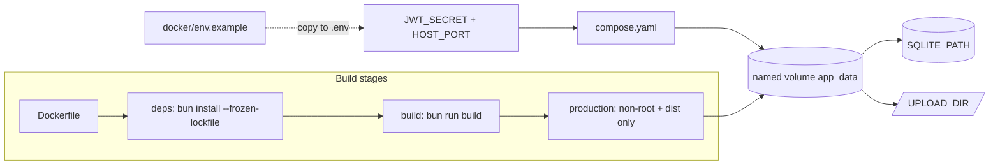

# Docker packaging

## Workflow

## Practices applied

- **Multi-stage image** — compile in `build`, ship only `dist/` plus Bun runtime.
- **Pinned base tag** — `BUN_DOCKER_TAG` matches `package.json` / lock (`oven/bun:1.3.10`).
- **Deterministic installs** — `bun install --frozen-lockfile`.
- **Non-root runtime** — `USER bun`, writable `/app/data` for SQLite + uploads.
- **Health check** — HTTP `GET /health` inside the container.
- **Compose** — named volume for persistence; **production requires `JWT_SECRET`** (same as non-container behavior).
- **Secrets** — `.env` gitignored; template at `docker/env.example`.

## Commands

| Script | Purpose |
| --- | --- |
| `bun run docker:build` | Build image `bunjs-hands-on:local` |
| `bun run docker:up` | Compose up (build + detach) |
| `bun run docker:down` | Compose down |
| `bun run docker:logs` | Follow app logs |

Before first `docker:up`, copy `docker/env.example` → `.env` and set `JWT_SECRET`.
