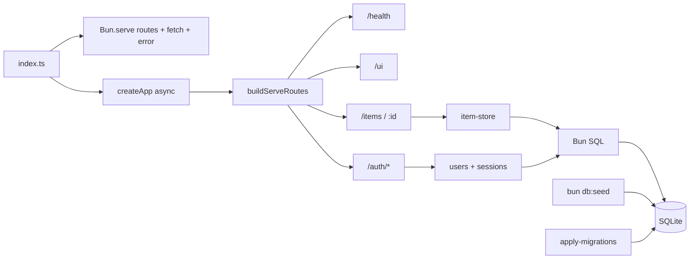
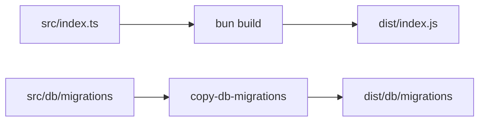
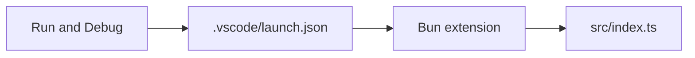
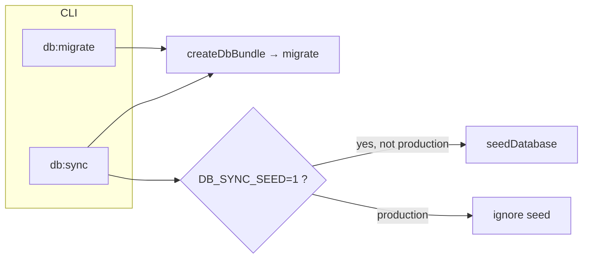
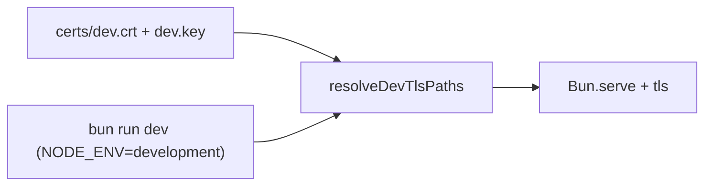

# Bun server + items CRUD

## Workflow



## Build output



## Standalone (`bun build --compile`)

`bun build --compile` runs code from **bundled `/$bunfs`** — **`import.meta.dir` is not a real folder**, so SQL migrations must come from disk beside the binary or from **`MIGRATIONS_FOLDER`**.

```mermaid
flowchart LR
  EX["process.execPath (not bun)"] --> S["dirname/exe/db/migrations"]
  ENV[MIGRATIONS_FOLDER] --> M[migrate()]
  S --> M
```

- **`bun run standalone`** — builds **`myapp`** and copies `src/db/migrations` → **`./db/migrations`** next to the project root so `./myapp` finds **`./db/migrations/meta/_journal.json`** (same layout when you ship the binary + `db/` folder).
- Override: **`MIGRATIONS_FOLDER`** (absolute or cwd-relative path to the migrations directory).

## Test runner speed


- **Lower bcrypt cost in tests only** via `tests/preload.ts` + `BCRYPT_COST_TEST` (`src/constants/bcrypt-cost.ts`). Production/runtime defaults stay at **12** when `BCRYPT_COST` is unset.
- **`bun test --concurrent`** (see `package.json`) runs independent `it()` blocks concurrently; **`bunfig.toml`** limits discovery to `tests/` and applies the preload.

## Editor debugging



Install **[Bun for VS Code](https://marketplace.visualstudio.com/items?itemName=oven.bun-vscode)** (workspace recommends it via `.vscode/extensions.json`). Use **Server: debug** or **Server: debug + watch**, or start `bun --inspect src/index.ts` and **Attach to Bun (terminal: bun --inspect …)**.

## Database sync (dev / prod)



- **`bun run db:migrate`** — applies Drizzle migrations to the **file** SQLite DB (`SQLITE_PATH`; refuses `:memory:`). Typical **production** step before **`start`** or in a container **init** job.
- **`bun run db:sync`** — migrate locally(after add migrations), then optionally seed when **`DB_SYNC_SEED=1`** (**never** when **`NODE_ENV=production`**). Shortcut: **`bun run db:sync:seed`** for local dev.
- **`scripts/db-sync.sh`** — POSIX wrapper (make executable: `chmod +x`) that runs **`bun scripts/db-sync.ts`** from the repo root for shell-based pipelines.

The server still runs **`migrate()`** inside **`createDbBundle()`** on startup (belt-and-suspenders).

## Dev HTTPS (TLS)



- Run **`bun run tls:gencert`** once (needs `openssl` on `PATH`) to create **gitignored** `certs/dev.key` and `certs/dev.crt` (see `certs/README.md`).
- With **`NODE_ENV=development`** and those files present, the server uses **`Bun.serve` `tls`** (`src/server/dev-tls.ts`). `bun run dev` and VS Code **Server: debug** set `NODE_ENV=development`. Any environment: set **`TLS_KEY_PATH`** and **`TLS_CERT_PATH`** to PEM files to enable TLS.

## Notes

- Runtime & tooling: **[Bun](https://bun.sh)** (`packageManager` / `bun.lock`). Scripts: `bun install`, `bun run …`. Tests: **`bun test`** (`bun:test`), config in **`bunfig.toml`**. Prefer **`bun:`** APIs and **`import.meta.dir`** where they replace Node-only path hacks (`src/db/client.ts`); use unprefixed builtins (`fs`, `path`, `crypto`, `url`) instead of `node:*`; Biome **`useNodejsImportProtocol`** is **off** in `biome.json` so that style stays lint-clean.
- Lint/format: [Biome](https://biomejs.dev) — `bun run lint` → `biome check .` (config: `biome.json`).
- Build: `bun run build` — **`bun build`** bundles `src/index.ts` → `dist/index.js` (Bun target, external sourcemaps), copies SQL migrations into `dist/db/migrations`. Run **`bun run start`** after build.
- Dev: `bun run dev` (`bun --watch src/index.ts`). `bun run start` runs sources directly.
- Debug: see **Editor debugging** above (`.vscode/launch.json`).
- Entry: `src/index.ts` uses **`Bun.serve`** with a **`routes`** map (`buildServeRoutes` in `src/server/serve-routes.ts`), a **`fetch`** fallback for unknown paths, and an **`error`** handler; port/hostname from env/constants. Graceful shutdown via **`await server.stop()`** and **`await app.close()`** (SQL connection) on `SIGINT`/`SIGTERM`.
- Health: `GET /health` → `{ "status": "ok" }`.
- Auth UI: `GET /ui` — HTML forms + fetch with `credentials: same-origin`.
- Auth API: `POST /auth/signup`, `/auth/signin`, `/auth/signout` — **`Bun.password`** (bcrypt for user passwords, `src/constants/password-hash.ts` + `BCRYPT_COST`) and SQLite sessions; signup requires unique **`username`** (normalized lowercase, `a-z`, `0-9`, `_`, length 3–32) plus email/password. Session cookie value is **`<sessionId>.<hexSecret>`**; **`sessions.token_hash`** stores **Argon2id PHC** strings from **`Bun.password.hashSync`** ([Argon2 PHC format](https://bun.com/docs/runtime/hashing#argon2-phc-format), options in `src/constants/session-token.ts`). **`0002_clear_sessions`** deletes legacy rows before relying on PHC-only verification.
- CRUD: `GET/POST /items`, `GET/PUT/DELETE /items/:id`.
- DB: **[Bun `SQL`](https://bun.sh/docs/api/sql)** (`new SQL(sqliteUrl)` in `src/db/client.ts`); queries via tagged templates in stores and route handlers. Migrations: ordered SQL under `src/db/migrations/` + `meta/_journal.json`, applied by `src/db/apply-migrations.ts` (same **`__drizzle_migrations`** bookkeeping as the former Drizzle migrator). New SQL migrations are added by hand (no `db:generate` script).
- Default DB file `data/items.sqlite`. Tests use `:memory:` via `tests/helpers/app-memory.ts` (in-process **`Bun.serve`** on a random port + `afterEach` disposal in `tests/dispose-guard.ts`). The helper calls **`fetch(serverUrl + path)`** so the **`routes`** table is exercised (`server.fetch()` would only hit the fallback `fetch` handler).
- Seed: `bun run db:seed` — faker data; password `seed-password` (`src/constants/seed.ts`).
