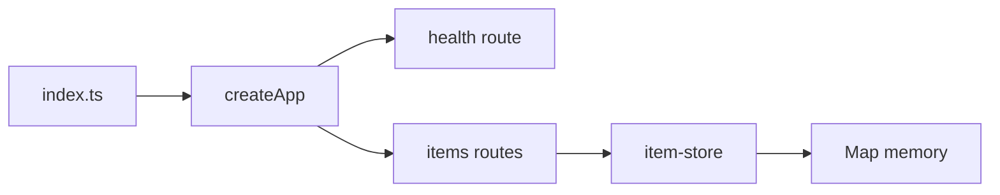

# Hono server + items CRUD

## Workflow

## Notes

- Lint/format: [Biome](https://biomejs.dev) — `pnpm lint` → `biome check .` (config: `biome.json`).
- Entry: `src/index.ts` binds `@hono/node-server` `serve` to `app.fetch`.
- Health: `GET /health` → `{ "status": "ok" }`.
- CRUD: `GET/POST /items`, `GET/PUT/DELETE /items/:id`.
- Store: in-memory `Map`, IDs via `crypto.randomUUID()`.
