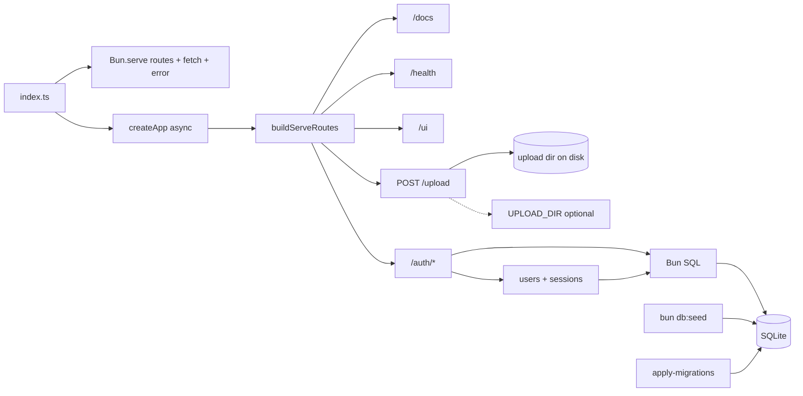
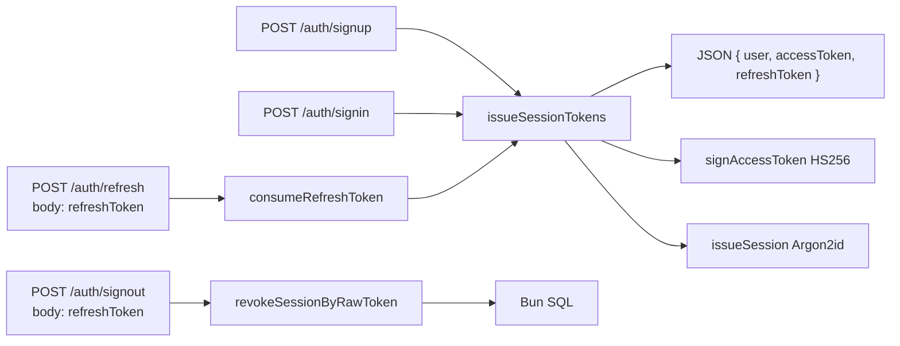
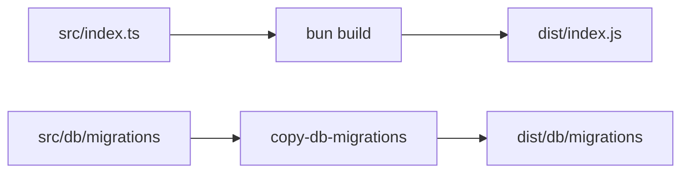
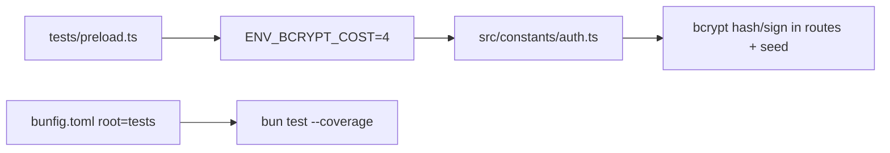
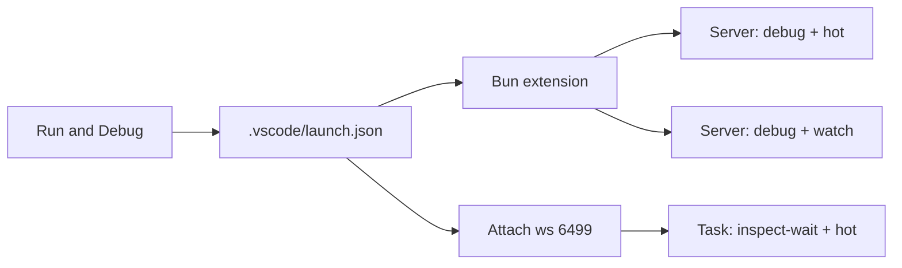
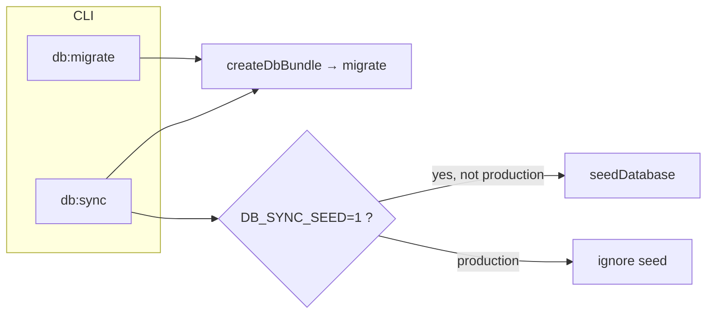
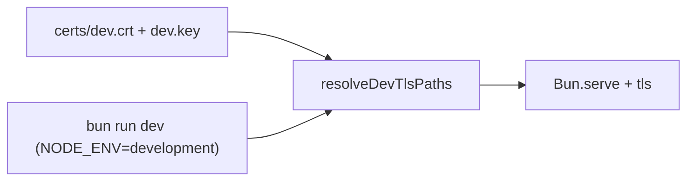
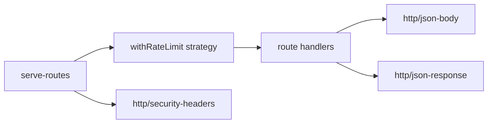

# Bun server + auth

## Workflow



## Auth tokens — access JWT + refresh session



## Password reset + email verification

```mermaid
flowchart LR
  FP["POST /auth/forgot-password\n{email}"] --> LU[lookup user by email]
  LU -->|found| ITP[issueAuthToken\npassword_resets]
  ITP --> ML((Mailer))
  FP --> G200[generic 200<br/>no enumeration]
  RP["POST /auth/reset-password\n{token,password}"] --> CTP[consumeAuthToken\npassword_resets]
  CTP --> UH[update password_hash]
  UH --> RAS[revokeAllSessionsForUser]
  SV["POST /auth/send-verification\n(Bearer access)"] --> JV[verifyAccessToken]
  JV --> ITE[issueAuthToken\nemail_verifications]
  ITE --> ML
  VE["GET /auth/verify-email?token"] --> CTE[consumeAuthToken\nemail_verifications]
  CTE --> EV[users.email_verified = 1]
```



- **Access token** — HS256 JWT, claims `{sub,iss,iat,exp}`, TTL **15 min** (`ACCESS_TOKEN_TTL_SECONDS`). Secret from **`JWT_SECRET`** env; required in production, ephemeral per-process in dev/test (`src/auth/jwt-secret.ts`). Bearer-protected routes verify it via `requireAccessToken`.
- **Refresh token** — long-lived opaque `<sessionId>.<hexSecret>` stored Argon2id-PHC hashed in `sessions`; rotated on `/auth/refresh` (old session deleted, new pair issued). Reset password deletes **all** sessions for the user.
- **Single-use tokens** — `password_resets` and `email_verifications` share the same `<uuid>.<hexSecret>` shape and Argon2id PHC hashing (`src/auth/auth-tokens.ts`). TTLs **30 min** / **24 h**; `used_at` blocks replay; FK `ON DELETE cascade` from `users`.
- **Mailer** — `Mailer` interface (`src/mail/mailer-types.ts`). Default driver from `MAILER_DRIVER` env: `console` (logs link via `console.info`, dev/prod default) or `noop`. Tests inject `createInMemoryMailer` via `createApp({ mailer })`. No 3rd-party SMTP client added; production wiring is a drop-in `Mailer` implementation.
- **Email link URL** — built from **`APP_PUBLIC_BASE_URL`** + route path + `?token=…` (`src/mail/mail-links.ts`).

## Build output



## Standalone (`bun build --compile`)

`bun build --compile` runs code from **bundled `/$bunfs`** — **`import.meta.dir` is not a real folder**, so SQL migrations must come from disk beside the binary or from **`MIGRATIONS_FOLDER`**.

```mermaid
flowchart LR
  EX["process.execPath (not bun)"] --> S["dirname/exe/db/migrations"]
  ENV[MIGRATIONS_FOLDER] --> M[migrate()]
  S --> M
```

- **`bun run standalone`** — builds **`myapp`** and copies `src/db/migrations` → **`./db/migrations`** next to the project root so `./myapp` finds **`./db/migrations/meta/_journal.json`** (same layout when you ship the binary + `db/` folder).
- Override: **`MIGRATIONS_FOLDER`** (absolute or cwd-relative path to the migrations directory).

## Test runner speed



- **Lower bcrypt cost in tests only** via `tests/preload.ts` + `BCRYPT_COST_TEST` (`src/constants/bcrypt-cost.ts`). Production/runtime defaults stay at **12** when `BCRYPT_COST` is unset.
- **`bun test --coverage`** (see `package.json`) runs tests sequentially so `tests/dispose-guard.ts` can drain HTTP servers after each case; **`bunfig.toml`** limits discovery to `tests/` and applies the preload. (`bun test --concurrent` is incompatible with **`onTestFinished`** and with the shared dispose queue used for **`Bun.serve`** helpers.)

## Editor debugging



Install **[Bun for VS Code](https://marketplace.visualstudio.com/items?itemName=oven.bun-vscode)** (workspace recommends it via `.vscode/extensions.json`).

- **`Server: debug + hot (recommended)`** — uses Bun **`--hot`** (soft reload). Avoids **`--watch`** full process restarts that often **drop the debugger** when files change (e.g. agent saves).
- **`Server: debug + watch`** — hard restart on change; fine without breakpoints, worse for **F5 + breakpoints** across saves.
- **Stable session while editing**: run task **`bun: server (inspect-wait + hot, then Attach)`** (Terminal → Run Task…), then **Run → Start Debugging** → **Attach to Bun** — the server keeps running in the terminal when you stop/restart only the attach session.
- Workspace **`bun.debugTerminal.enabled`** — Bun integrates with the editor’s **JavaScript Debug Terminal** for `bun --watch` / errors inline (see extension README).

## Database sync (dev / prod)



- **`bun run db:migrate`** — applies SQL migrations to the **file** SQLite DB (`SQLITE_PATH`; refuses `:memory:`). Typical **production** step before **`start`** or in a container **init** job.
- **`bun run db:sync`** — migrate locally(after add migrations), then optionally seed when **`DB_SYNC_SEED=1`** (**never** when **`NODE_ENV=production`**). Shortcut: **`bun run db:sync:seed`** for local dev.
- **`scripts/db-sync.sh`** — POSIX wrapper (make executable: `chmod +x`) that runs **`bun scripts/db-sync.ts`** from the repo root for shell-based pipelines.

The server still runs **`migrate()`** inside **`createDbBundle()`** on startup (belt-and-suspenders).

## Dev HTTPS (TLS)



- Run **`bun run tls:gencert`** once (needs `openssl` on `PATH`) to create **gitignored** `certs/dev.key` and `certs/dev.crt` (see `certs/README.md`).
- With **`NODE_ENV=development`** and those files present, the server uses **`Bun.serve` `tls`** (`src/server/dev-tls.ts`). `bun run dev` and VS Code **Server: debug** set `NODE_ENV=development`. Any environment: set **`TLS_KEY_PATH`** and **`TLS_CERT_PATH`** to PEM files to enable TLS.

## HTTP security



- **Response headers** (`src/http/security-headers.ts`, values in `src/constants/http-security.ts`): `X-Content-Type-Options: nosniff`, `X-Frame-Options: DENY`, `Referrer-Policy`, `Permissions-Policy` on routes and JSON fallbacks; **CSP** on HTML (`/docs`, `/ui`); **HSTS** when the request URL is **`https:`** (e.g. dev TLS).
- **Auth JSON bodies**: max size **`MAX_JSON_BODY_BYTES`** (`src/constants/http-security.ts`) enforced in **`readJsonUnknown`** (`src/http/json-body.ts`) → **413** with **`MSG_PAYLOAD_TOO_LARGE`**.
- **Tiered rate limit** (`src/server/with-rate-limit.ts` + `src/http/rate-limit.ts`): sliding window per `(strategy, clientKey)` using `X-Forwarded-For` (first hop) → `X-Real-IP` → shared `unknown` bucket. Defaults / env overrides (`src/constants/rate-limit.ts`):
  - **strict** — `10` req / 60 s — `RATE_LIMIT_STRICT_MAX` — signup, signin, refresh, forgot-password, reset-password, send-verification (brute-force / enumeration shield)
  - **standard** — `60` req / 60 s — `RATE_LIMIT_STANDARD_MAX` — signout, upload, verify-email
  - **relaxed** — `300` req / 60 s — `RATE_LIMIT_RELAXED_MAX` — health, docs, ui
  - 429 response includes `Retry-After` seconds; tests use `setRateLimitMaxOverrideForTests(strategy, max)`.
- **JSON auth responses** use **`jsonApiResponse`** (`src/http/json-response.ts`) so errors and successes carry the same baseline headers as other API responses.

## Notes

- Runtime & tooling: **[Bun](https://bun.sh)** (`packageManager` / `bun.lock`). Scripts: `bun install`, `bun run …`. Tests: **`bun test`** (`bun:test`), config in **`bunfig.toml`**. Prefer **`bun:`** APIs and **`import.meta.dir`** where they replace Node-only path hacks (`src/db/client.ts`); use unprefixed builtins (`fs`, `path`, `crypto`, `url`) instead of `node:*`; Biome **`useNodejsImportProtocol`** is **off** in `biome.json` so that style stays lint-clean.
- Lint/format: [Biome](https://biomejs.dev) — `bun run lint` → `biome check .` (config: `biome.json`).
- Build: `bun run build` — **`bun build`** bundles `src/index.ts` → `dist/index.js` (Bun target, external sourcemaps), copies SQL migrations into `dist/db/migrations`. Run **`bun run start`** after build.
- Dev: `bun run dev` (`bun --watch src/index.ts`). `bun run start` runs sources directly.
- Debug: see **Editor debugging** above (`.vscode/launch.json`).
- Entry: `src/index.ts` uses **`Bun.serve`** with a **`routes`** map (`buildServeRoutes` in `src/server/serve-routes.ts`), a **`fetch`** fallback for unknown paths, and an **`error`** handler; port/hostname from env/constants. Graceful shutdown via **`await server.stop()`** and **`await app.close()`** (SQL connection) on `SIGINT`/`SIGTERM`.
- Health: `GET /health` → `{ "status": "ok" }`.
- Docs: `GET /docs` — **HTML** (light theme), endpoints grouped under **`Health`**, **`Auth UI`**, **`Auth`** (with **Signup / Signin / Signout** labels + path subtitle); curl in `<pre>` with **copy** per block; success shows **check** + green styling (no Swagger/OpenAPI). Served only when **`NODE_ENV=development`** (`bun run dev`); **`NODE_ENV=production`** (`bun run start`) returns **404**. Tests override via **`docsAccess`** on **`createApp`** (`development` / `production` / default **`env`**).
- Auth UI: `GET /ui` — HTML forms + fetch with `credentials: same-origin`; stores **`accessToken`** + **`refreshToken`** in **`sessionStorage`** after signup/signin and sends the **refresh token in the JSON body** on signout.
- Auth API: `POST /auth/signup`, `/auth/signin`, `/auth/signout`, `/auth/refresh`, `/auth/forgot-password`, `/auth/reset-password`, `/auth/send-verification`, `GET /auth/verify-email` — **`Bun.password`** (bcrypt for user passwords, `src/constants/password-hash.ts` + `BCRYPT_COST`) and SQLite sessions; signup requires unique **`username`** (normalized lowercase, `a-z`, `0-9`, `_`, length 3–32) plus email/password. **Signup/signin/refresh** return JSON `{ user?, accessToken, refreshToken }`. Clients send **`Authorization: Bearer <accessToken>`** on protected calls (e.g. **`/auth/send-verification`**) and send `{ refreshToken }` JSON body on **`/auth/refresh`** + **`/auth/signout`**. **`sessions.token_hash`** stores **Argon2id PHC** strings from **`Bun.password.hashSync`** ([Argon2 PHC format](https://bun.com/docs/runtime/hashing#argon2-phc-format), options in `src/constants/session-token.ts`). **`0002_clear_sessions`** deletes legacy rows before relying on PHC-only verification. **`0004_email_auth_tokens`** adds `users.email_verified`, `password_resets`, `email_verifications`. See **HTTP security** above for headers, body size cap, and rate limiting on these routes.
- DB: **[Bun `SQL`](https://bun.sh/docs/api/sql)** (`new SQL(sqliteUrl)` in `src/db/client.ts`); queries via tagged templates in route handlers. Migrations: ordered SQL under `src/db/migrations/` + `meta/_journal.json`, applied by `src/db/apply-migrations.ts` (same **`__drizzle_migrations`** bookkeeping as the former Drizzle migrator). New SQL migrations are added by hand (no `db:generate` script).
- Default DB file `data/items.sqlite`. Tests use `:memory:` via `tests/helpers/app-memory.ts` (in-process **`Bun.serve`** on a random port + `afterEach` disposal in `tests/dispose-guard.ts`). The helper calls **`fetch(serverUrl + path)`** so the **`routes`** table is exercised (`server.fetch()` would only hit the fallback `fetch` handler).
- Seed: `bun run db:seed` — faker data; password `seed-password` (`src/constants/seed.ts`).
