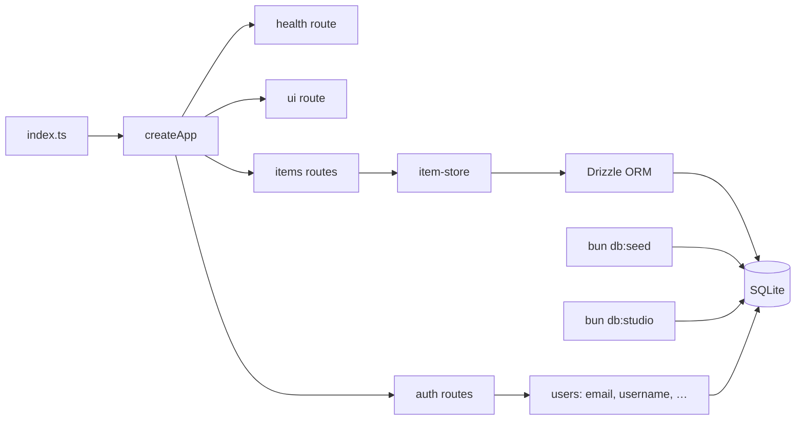
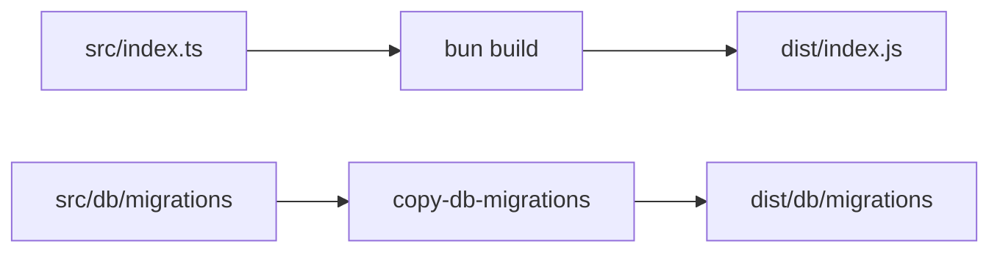
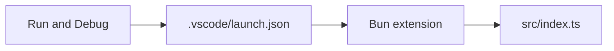
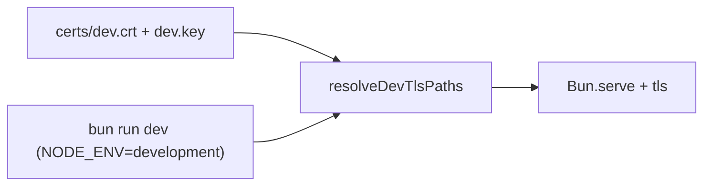

# Hono server + items CRUD

## Workflow

## Build output

## Test runner speed

- **Lower bcrypt cost in tests only** via `tests/preload.ts` + `BCRYPT_COST_TEST` (`src/constants/bcrypt-cost.ts`). Production/runtime defaults stay at **12** when `BCRYPT_COST` is unset.
- **`bun test --concurrent`** (see `package.json`) runs independent `it()` blocks concurrently; **`bunfig.toml`** limits discovery to `tests/` and applies the preload.

## Editor debugging

Install **[Bun for VS Code](https://marketplace.visualstudio.com/items?itemName=oven.bun-vscode)** (workspace recommends it via `.vscode/extensions.json`). Use **Server: debug** or **Server: debug + watch**, or start `bun --inspect src/index.ts` and **Attach to Bun (terminal: bun --inspect …)**.

## Dev HTTPS (TLS)

- Run **`bun run tls:gencert`** once (needs `openssl` on `PATH`) to create **gitignored** `certs/dev.key` and `certs/dev.crt` (see `certs/README.md`).
- With **`NODE_ENV=development`** and those files present, the server uses **`Bun.serve` `tls`** (`src/server/dev-tls.ts`). `bun run dev` and VS Code **Server: debug** set `NODE_ENV=development`. Any environment: set **`TLS_KEY_PATH`** and **`TLS_CERT_PATH`** to PEM files to enable TLS.

## Notes

- Runtime & tooling: **[Bun](https://bun.sh)** (`packageManager` / `bun.lock`). Scripts: `bun install`, `bun run …`. Tests: **`bun test`** (`bun:test`), config in **`bunfig.toml`**. Prefer **`bun:`** APIs and **`import.meta.dir`** where they replace Node-only path hacks (`src/db/client.ts`); use unprefixed builtins (`fs`, `path`, `crypto`, `url`) instead of `node:*`; Biome **`useNodejsImportProtocol`** is **off** in `biome.json` so that style stays lint-clean.
- Lint/format: [Biome](https://biomejs.dev) — `bun run lint` → `biome check .` (config: `biome.json`).
- Build: `bun run build` — **`bun build`** bundles `src/index.ts` → `dist/index.js` (Bun target, external sourcemaps), copies SQL migrations into `dist/db/migrations`. Run `bun run start:dist` after build.
- Dev: `bun run dev` (`bun --watch src/index.ts`). `bun run start` runs sources directly.
- Debug: see **Editor debugging** above (`.vscode/launch.json`).
- Entry: `src/index.ts` uses **`Bun.serve`** (`fetch: app.fetch`, port/hostname from env/constants); graceful shutdown via **`await server.stop()`** on `SIGINT`/`SIGTERM`.
- Health: `GET /health` → `{ "status": "ok" }`.
- Auth UI: `GET /ui` — HTML forms + fetch with `credentials: same-origin`.
- Auth API: `POST /auth/signup`, `/auth/signin`, `/auth/signout` — bcrypt + SQLite sessions; signup requires unique **`username`** (normalized lowercase, `a-z`, `0-9`, `_`, length 3–32) plus email/password.
- CRUD: `GET/POST /items`, `GET/PUT/DELETE /items/:id`.
- DB: [Drizzle ORM](https://orm.drizzle.team) + **`bun:sqlite`** (`drizzle-orm/bun-sqlite`); migrations in `src/db/migrations/`; `bun run db:generate` via drizzle-kit.
- Drizzle Studio: `bun run db:studio` — GUI at default `http://localhost:4983`. Matches `SQLITE_PATH` / default file (`drizzle.config.ts`); `:memory:` falls back for CLI with a warning.
- Default DB file `data/items.sqlite`. Tests use `:memory:` via `tests/helpers/app-memory.ts`.
- Seed: `bun run db:seed` — faker data; password `seed-password` (`src/constants/seed.ts`).
