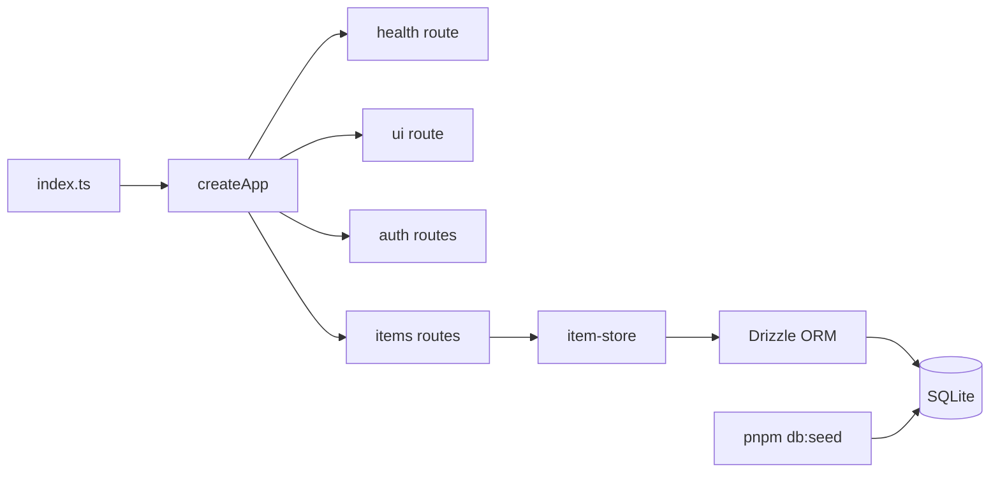

# Hono server + items CRUD

## Workflow

## Notes

- Lint/format: [Biome](https://biomejs.dev) — `pnpm lint` → `biome check .` (config: `biome.json`).
- Dev reload: `pnpm dev` runs `tsx watch` with `--include ./src` (restarts the process on source changes; not in-process HMR). `pnpm start` is a single run with no watch.
- Entry: `src/index.ts` binds `@hono/node-server` `serve` to `app.fetch` and closes the HTTP server on `SIGINT`/`SIGTERM` so watch mode can restart cleanly.
- Health: `GET /health` → `{ "status": "ok" }`.
- Auth UI: `GET /ui` — minimal HTML forms calling the JSON auth API with `credentials: same-origin` (same server).
- Auth (cookie `session`): `POST /auth/signup`, `POST /auth/signin`, `POST /auth/signout` — passwords hashed with bcrypt; sessions stored in SQLite (`sessions` table).
- CRUD: `GET/POST /items`, `GET/PUT/DELETE /items/:id`.
- DB: [Drizzle ORM](https://orm.drizzle.team) + [`better-sqlite3`](https://github.com/WiseLibs/better-sqlite3); migrations in `src/db/migrations/`; `pnpm db:generate` regenerates from `src/db/schema.ts`.
- Default file `data/items.sqlite` (`SQLITE_PATH` override). Tests use `:memory:` via `tests/helpers/app-memory.ts`.
- Dev seed: `pnpm db:seed` — clears `sessions`, `users`, `items`, then inserts fake users/items ([`@faker-js/faker`](https://fakerjs.dev)); all seeded users share password `seed-password` (see `src/constants/seed.ts`).
